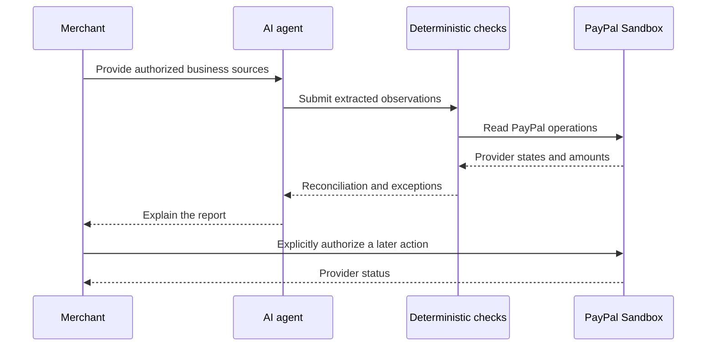

# Durin

Durin is an AI-assisted financial operations workspace for merchants who need to
understand their PayPal activity, reconcile it with invoices and payment terms,
and keep payment authorization under explicit human control.

The name references the Doors of Durin: they open only when the correct word is
known. In Durin, an operation does not become reconciled merely because an email,
an invoice, or an AI explanation says that it happened. The evidence and the
merchant's rules must support the conclusion before PayPal activity is treated
as financially matched.

## The merchant problem

Small and mid-sized merchants receive invoices, contracts, and payment
communications in different places while PayPal records the resulting activity
separately. They have to answer questions that are easy to miss under time
pressure:

- Is this supplier invoice new, duplicated, or already paid?
- Does the supplier identity and destination match the merchant's records?
- Is the amount within policy and consistent with payment history?
- Is the operation completed, returned, disputed, or still pending?
- What does the merchant need to review before authorizing a payout?
- Which conclusions require human review?

The payment button is not the difficult part. The difficult part is knowing
whether the obligation, PayPal operation, and money movement actually match.

## What Durin does

Durin gives a merchant one controlled operations workflow:

1. The agent collects authorized invoices, contracts, communications, and policy.
2. The MCP exposes bounded tools for reading and comparison.
3. AI extracts candidate facts with source evidence and review requirements.
4. Deterministic automation organizes suppliers, detects duplicates, resolves
   conflicts, and matches obligations with payment operations.
5. Durin reports ready, blocked, pending, returned, unmatched, and ambiguous cases.
6. The merchant reviews any operation that requires approval; PayPal remains the
   source of provider activity.

The agent prepares and explains the work. The merchant remains the authority for
any monetary action.

## Why merchants use it

Durin is designed for merchants who want automation without giving an AI an
unbounded payment capability. It reduces repetitive review while keeping the
important decision visible:

| Before Durin | With Durin |
| --- | --- |
| Search across invoices, contracts, and messages | One evidence-backed operations workspace |
| Manually compare documents with PayPal activity | Deterministic matching and exception reasons |
| Trust an opaque recommendation | Source evidence and review state for every conclusion |
| Lose track of fees, refunds, and pending operations | PayPal activity reconciled by period |

## AI and authorization boundary

AI is used for investigation, extraction, summarization, and explanation. It may
prepare a proposal, but it must not silently approve or capture a payment.

The authorization boundary is explicit:



The MCP is an interface for bounded capabilities, not a replacement for the
merchant's authorization.

## PayPal integration

PayPal is the payment rail and the central external integration. Durin targets
the PayPal Developer Platform and PayPal Sandbox during development. Credentials
belong only in server-side environment variables; they are never placed in the
browser, prompts, tests, or Git history.

The application will use PayPal's APIs for the payment lifecycle and will keep
the merchant-facing workflow separate from the AI reasoning layer. PayPal's
official developer documentation is the source of truth for API behavior:
[PayPal Developer](https://developer.paypal.com/).

## Scope

### In scope

- Merchant financial operations and reconciliation.
- `PAYABLE` supplier obligations and PayPal payout preparation as the first complete flow.
- Invoice, contract, and communication observations with AI extraction and provenance.
- Deterministic matching, balances, and duplicate checks.
- MCP tools for the agent.
- PayPal Payouts Sandbox integration as the mandatory next complete level.
- Audit-friendly operational records.
- Explainable period reports.

### Out of scope

- An AI-controlled private key or unattended payment capture.
- `RECEIVABLE` until the supplier domain and the relevant PayPal payout capability are established.
- A full accounting replacement.

## Repository status

Durin is being rebuilt as a standalone application. The first complete product
level is supplier intelligence: authorized source ingestion, AI extraction,
provenance, deterministic automation, reconciliation, metrics, and reports.
The mandatory second level integrates PayPal Payouts end to end. `RECEIVABLE`
is a separate post-hackathon domain. Frontend code will be selected and added
later from the repositories designated for this project.

See [construction levels](docs/CONSTRUCTION_LEVELS.md) for the destination,
cross-level contracts, adversarial gates, and open constraints.

## Development

The offline PayPal client, durable authorization ledger, recovery path, and
configuration preflight are available. Run the preflight before any authorized
Sandbox execution:

```shell
set -a
. ./.env
set +a
python3 scripts/paypal_preflight.py
```

The preflight performs no network request and sends no transaction. Live
Sandbox execution still requires explicit merchant authorization and provider
lookup/recovery handling.

## License

Apache-2.0. See [LICENSE](LICENSE).
