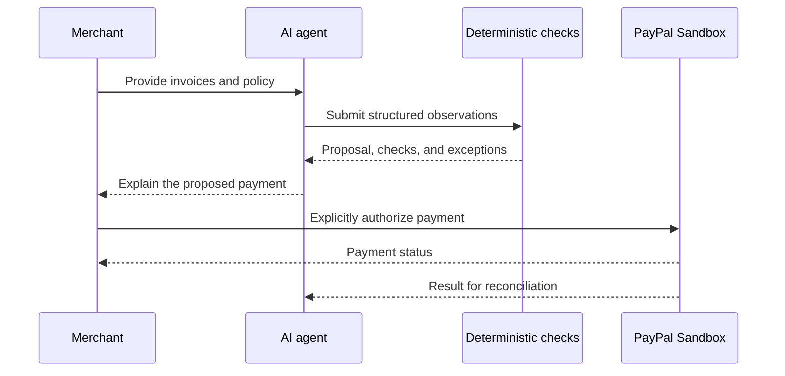

# Durin

Durin is an AI-assisted payment workspace for merchants who need to pay
suppliers without turning payment approval into a blind leap of faith.

The name references the Doors of Durin: they open only when the correct word is
known. In Durin, a payment request does not open the payment flow merely because
someone asked for it. The request must satisfy the merchant's authorization
conditions before PayPal can be used.

## The merchant problem

Small and mid-sized merchants receive invoices through email, documents, and
messages. Before paying, someone has to answer questions that are easy to miss
under time pressure:

- Is this invoice new or a duplicate?
- Does the supplier and amount match the merchant's records?
- Is the request within the merchant's approval policy?
- What evidence supports the payment?
- What happened after the payment was authorized?

The payment button is not the difficult part. The difficult part is preparing a
payment that a merchant can understand, authorize, and later explain.

## What Durin does

Durin gives a merchant one controlled workflow:

1. The agent collects invoices, supplier context, and the merchant's policy.
2. The MCP exposes bounded tools for reading, comparison, and preparation.
3. Deterministic automation checks duplicates, recipients, amounts, limits, and
   missing evidence.
4. The agent explains the proposed payment and the reasons behind every exception.
5. The merchant reviews the proposal and explicitly authorizes the payment.
6. PayPal Sandbox processes the authorized payment and the result is recorded for
   reconciliation.

The agent prepares the work. The merchant remains the authority for moving money.
Durin has no blockchain, smart contracts, cryptocurrency, wallet, or independent
on-chain verifier.

## Why merchants use it

Durin is designed for merchants who want automation without giving an AI an
unbounded payment capability. It reduces repetitive review while keeping the
important decision visible:

| Before Durin | With Durin |
| --- | --- |
| Search across invoices and messages | One proposed payment workspace |
| Manually compare supplier details | Deterministic comparison and exception reasons |
| Trust an opaque recommendation | Evidence and policy checks shown before approval |
| Lose track of the post-payment result | PayPal status available for reconciliation |

## AI and authorization boundary

AI is used for investigation, extraction, summarization, and explanation. It may
prepare a proposal, but it must not silently approve or capture a payment.

The authorization boundary is explicit:

The MCP is an interface for bounded capabilities, not a replacement for the
merchant's authorization.

## PayPal integration

PayPal is the payment rail and the central external integration. Durin targets
the PayPal Developer Platform and PayPal Sandbox during development. Credentials
belong only in server-side environment variables; they are never placed in the
browser, prompts, tests, or Git history.

The application will use PayPal's APIs for the payment lifecycle and will keep
the merchant-facing workflow separate from the AI reasoning layer. PayPal's
official developer documentation is the source of truth for API behavior:
[PayPal Developer](https://developer.paypal.com/).

## Scope

### In scope

- Merchant payment preparation and review.
- Invoice and supplier observations.
- Deterministic policy and duplicate checks.
- MCP tools for the agent.
- PayPal Sandbox order and payment status integration.
- Audit-friendly operational records.
- A runnable web application and clear setup instructions.

### Out of scope

- Blockchain or smart-contract payments.
- Wallets, tokens, RPCs, and on-chain verification.
- An AI-controlled private key or unattended payment capture.
- An independent blockchain proof portal.
- A full accounting replacement.

## Repository status

Durin is being rebuilt as a standalone application. The first implementation
priority is the merchant backend: MCP, agent capabilities, deterministic
automation, and PayPal integration. Frontend code will be selected and added
later from the repositories designated for this project.

## Development

Setup instructions, environment variables, tests, and the local PayPal Sandbox
workflow will be added as each backend module is introduced. Until then, this
README defines the product boundary and authorization model; it does not claim
that an unfinished integration is already available.

## License

Apache-2.0. See [LICENSE](LICENSE).
